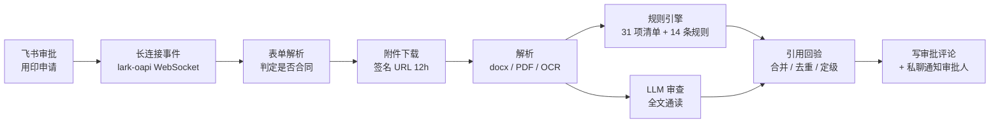

# 飞书 AI 合同预审机器人

在企业提交「用印申请」审批的那一刻，自动读完合同全文，30 秒内在审批单里写一条能直接执行的结论：**暂缓用印 / 建议先确认再用印 / 可按常规用印**。


> 约 4,500 行 Python｜93 项单元测试｜31 项检查清单 + 14 条确定性规则｜单份合同 31–78 秒｜已在一家制造业企业真实生产使用

## 它解决什么问题

制造企业的销售、采购谈完合同，要走「用印申请」审批才能盖章。法务通常只有一两个人，旺季一天十几份合同，审批单在法务节点上排队，行政同事只能凭经验扫一眼就放行。

风险不是没人看见，而是没人有时间逐条看：签约主体把责任转给第三方、正文和附件金额对不上、收款账户是个人卡、验收异议期只有 7 个工作日——这些都能在原文里找到依据，但通读一遍要 20 分钟。

机器人接管这一步：订阅审批事件，自动拉取表单里的合同附件，先跑确定性规则，再让模型通读全文，最后把结论写回审批单评论，并私聊通知审批人。私聊直接发合同文件也能审，走同一套链路。

## 效果示例

同一份安防工程安装合同（正文与附件金额不一致、签约主体为三方），机器人在审批单里写的评论如下（公司名与人名已脱敏）：

```
【AI 合同预审】用印申请（合同/非合同）｜real_contract.pdf
结论：暂缓用印（高 4 / 中 4 / 低 2）｜先确认：责任主体虚化、合同金额前后不一致、付款账户风险
金额 10057元（大写：壹万零伍拾柒元整）【含税价】｜对方 珠海某智能科技有限公司（乙方）
1. [高] 责任主体虚化｜原文「1、丙方某某系本工程的实际施工人…唯一承担主体…」｜解释：签约主体把履约责任转给第三方或自然人，我方追责时可能只能找到无履约能力的实际施工人。
2. [高] 合同金额前后不一致｜原文「工程总造价为 10057；工程总造价： ¥8,905.00」｜解释：正文与附件/开票口径出现 2 个不同金额…
3. [高] 付款账户风险｜原文「甲方款项一律支付至乙方指定对公账户…乙方仅承诺转付」
4. [高] 验收异议期过短｜原文「若甲方有异议，须在验收后7个工作日内提出，否则，视为弃权或认可处理。」
签约前必问：乙方是否对丙方的履约行为承担连带责任？；工程验收的具体标准和流程是什么？
AI 自动生成，仅供参考，最终以法务意见为准。
```

结构是固定的：**一行行动指令 → 金额与对方主体 → 最多 4 条风险（每条带逐字原文）→ 最多 2 条签约前必问 → 免责声明**，总行数不超过 12 行，手机上能一屏看完。

## 核心设计

### 怎么保证模型不编造条款？

每条模型结论必须带 `quote` 字段：从原文逐字复制的连续 8–120 字。系统用 `quote_in_text()` 回查原文，找不到对应句子就**整条丢弃**，不进报告。

对"合同里缺了某条款"这类判断，要求 `quote=""` 且 `missing=true`，并且还要过一道 `_contradicted_by_text` 闸门：如果正文里其实写了这条，就判定为误报丢弃。宁可少报一条，不可错报一条——错报会让审批人直接不再信任这个机器人。

### 为什么不做两轮审查？

最初的方案是第一轮自由发散找风险、第二轮带着清单挑高危。实测单份耗时从 45 秒涨到 112 秒，而第二轮新增的漏报很少。

审批人不会为一个用印申请等两分钟，等待时间一长，人就直接点"同意"绕过去了。最终改成单份提示词里同时写"自由发散"和"高危清单 R1–R17"，一次调用出全部结论，31–78 秒完成。

### PDF 版面断行把句子切断怎么办？

`pypdf` 按版面提取文本时会把一行切成两行，「向甲方所\n在地」这样断开后，模型只看到半句，于是报出「争议解决地不在我方所在地」这种完全错误的结论。

修法是 `_join_soft_breaks()`：只有句末标点、新条款序号（`一、`、`1.`）、表格行才被认作真实换行，其余都拼回整句。这类幻觉靠提示词压不住，必须在进模型之前把文本恢复成可读的句子。

### 规则和模型怎么分工？

| 判断类型 | 交给谁 | 典型项 |
| --- | --- | --- |
| 语义风险 | LLM | 责任主体虚化、权利义务失衡、条款表述含糊 |
| 确定性事实 | 规则引擎 | 金额口径不一致、期限已届满、收款到个人账户、违约金方向 |

理由是两条：确定性事实（金额算没算对、日期过没过）让模型去算，既慢又不可靠；语义判断（这句话是不是在转移责任）写成正则，永远写不全。

违约金方向是踩过坑的地方：模型曾把「丙方逾期赔我方 10%」报成「违约金比例偏高，建议下调」——方向完全反了，这笔钱是赔给我方的。修法是先用规则判定这笔钱赔给谁，赔给我方的比例再高也不是风险；再加一道后处理，凡建议「提高我方违约金」的结论直接丢弃。

### 模型被限流了怎么办？

用的免费模型白天会整片 429。`llm.py` 里把失败分成两类：可重试（429 / 5xx / 超时）与致命（401、key 无效）。配了备用模型时，429 立即切到下一个模型，不耗退避时间；没有备用才退避重试。模型全挂时，规则引擎单独也能出一份结论，只是没有语义风险条目。

### 怎么让非法律的行政同事真的照着做？

早期输出是 21 条风险加一句「高5/中11/低5」，行政同事的原话是「看完更累了」——信息完整，但没有一个动作可以执行。

改成开头一行行动指令，风险压到最多 4 条，必问压到 2 条，总行数 ≤12。另外私聊收到文件时会先回执一句「已收到《X》，正在审查，结果预计 1 分钟内回复」，否则用户在等待期间会以为服务没启动，转头又发一遍。

## 架构



没有公网 IP 也能跑：事件走 `lark-oapi` 的 WebSocket 长连接，不需要暴露回调地址。

## 快速开始

```bash
git clone https://github.com/YOUR_GITHUB_NAME/feishu-contract-reviewer.git
cd feishu-contract-reviewer
pip install -r requirements.txt
python -m src.cli contract-demo     # 零配置本地演示，不连飞书
```

`contract-demo` 会在终端打印一份完整的审批评论样稿，用的是 `data/sample_contract.txt`——一份故意埋了多处风险的样例合同（个人账户收款、仲裁与诉讼并存、违约金按日 1%、单方解除权、赔偿范围敞口、缺含税与发票条款），不需要任何密钥。想直接看规则引擎的判定：

```bash
python -m src.cli review-contract data/sample_contract.txt
```

### 接真实飞书需要什么

1. 在飞书开放平台建一个**企业自建应用**，开启长连接，拿到 `App ID` / `App Secret`；
2. 订阅「审批实例状态变更」事件，并给应用授予审批、云文档、消息相关权限；
3. 复制 `.env.example` 为 `.env`，填 `FEISHU_APP_ID` / `FEISHU_APP_SECRET`，把 `CONTRACT_APPROVAL_CODES` 设成「用印申请」的审批定义 Code；
4. `CONTRACT_COMMENT_OPEN_ID` 填一个真实用户（飞书不支持应用身份发审批评论，评论需要用某个人的身份署名）；
5. 启动：`python -m src.cli contract-bot`。

完整步骤、权限清单和常见报错见 [docs/approval-integration.md](docs/approval-integration.md)；审查口径与规则清单见 [docs/contract-review.md](docs/contract-review.md)，提示词设计见 [docs/prompt-high-risk-glm-air.md](docs/prompt-high-risk-glm-air.md)。

## 项目结构

```
feishu-contract-reviewer/
├── src/
│   ├── cli/                  # 命令行入口（按功能拆分的子命令）
│   ├── contract/
│   │   ├── models.py         # 数据模型（Finding / ReviewResult）
│   │   ├── evidence.py       # 引用回验、立场判定、噪声否决
│   │   ├── rules/            # 确定性规则（金额、违约金、主体、管辖、期限、权力失衡、缺失条款）
│   │   ├── checklist.py      # 31 项固定清单
│   │   ├── reviewer.py       # 审查编排：合并、去重、定级、排序
│   │   ├── summary.py        # 合同梗概抽取（类型、双方、金额、付款、期限）
│   │   ├── llm_reviewer.py   # 提示词与模型调用
│   │   ├── parser.py         # docx / PDF 解析与软换行合并
│   │   ├── ocr.py            # 扫描件本地 OCR
│   │   ├── kind.py           # 补充协议识别
│   │   ├── approval.py       # 审批接入：表单解析、一致性核对、评论生成
│   │   ├── bot.py            # 长连接机器人
│   │   ├── cards.py          # 卡片渲染
│   │   ├── render.py         # 报告渲染（md / json / docx）
│   │   └── store.py          # 记录存储
│   ├── feishu_api.py         # 飞书 REST 客户端
│   ├── feishu_auth.py        # 用户 OAuth
│   ├── llm.py                # LLM 客户端（超时、重试、模型降级链）
│   ├── dates.py              # 中文日期口语解析（「下周三」→ 时间戳）
│   └── config.py             # 配置
├── tests/                    # 93 项单元测试
├── docs/                     # 接入文档、审查口径、提示词设计说明
├── data/sample_contract.txt  # 内置样例合同（故意埋了坑）
└── .env.example
```

链路分层很硬：`parser.py` 只负责把文件变成干净文本，`rules/` 和 `llm_reviewer.py` 各自只产出候选结论，`evidence.py` 负责回验，`reviewer.py` 负责合并定级，`render.py` 只做排版。所以任何一层都能单独跑测试，不依赖飞书也不依赖模型。

## 配置说明

所有配置来自环境变量或 `.env`，代码里不硬编码密钥。主要项：

| 变量名 | 是否必填 | 说明 |
| --- | --- | --- |
| `FEISHU_APP_ID` | 必填 | 自建应用 App ID |
| `FEISHU_APP_SECRET` | 必填 | 自建应用 App Secret |
| `CONTRACT_APPROVAL_CODES` | 审批链路必填 | 要接管的审批定义 Code，多个用逗号分隔 |
| `CONTRACT_COMMENT_OPEN_ID` | 写评论时必填 | 评论署名用户的 `open_id` |
| `LLM_API_KEY` | 建议填 | OpenAI 兼容接口的 key；不填则只跑规则引擎 |
| `LLM_BASE_URL` | 否 | 默认 `https://api.deepseek.com/v1` |
| `LLM_MODEL` | 否 | 主模型名 |
| `LLM_FALLBACK_MODELS` | 否 | 备用模型链，逗号分隔，按顺序切换 |
| `OUR_COMPANIES` | 建议填 | 我方签约主体全称，用于判定签约主体是否为我方 |
| `OUR_LOCATIONS` | 建议填 | 我方所在地，用于判断管辖地是否有利 |
| `CONTRACT_PENALTY_MAX_PCT` | 否 | 违约金占合同额上限（%），默认 30 |
| `CONTRACT_OCR_ENABLED` | 否 | 扫描件 PDF 是否走本地 OCR，默认开启 |
| `CONTRACT_OCR_MAX_PAGES` | 否 | 超过此页数不自动 OCR，默认 30（约 10 秒/页） |
| `CONTRACT_MAX_MB` | 否 | 单份合同大小上限，默认 20 |
| `CONTRACT_NOTIFY_APPROVERS` | 否 | 是否私聊通知审批人，默认关闭以免打扰 |
| `CONTRACT_CHAT_IDS` | 否 | 允许直接发合同审查的群，群聊里不 @ 也处理 |

完整变量表见 `.env.example`。

## 能力边界与已知限制

- **扫描件 OCR 对印章敏感**：红章盖在关键条款上时，识别结果会出现字符丢失或串行，套印区域附近的结论需要人工复核。超过 30 页的扫描件不自动识别，直接提示转人工。
- **合同类型面向商事合同**：买卖、租赁、工程安装、服务外包这类合同的清单和规则是调过的；劳动合同、股权协议、涉外合同没有针对性调优，结论仅供参考。
- **审批评论有长度限制**：飞书评论字段放不下完整报告，所以评论只写结论和最多 4 条风险，完整报告落在 `out/contracts/`，需要细节再去看文件。
- **模型会对小额合同主动降噪**：金额很小的合同，模型会合并同类风险、减少条目，避免把一份 8,000 元的采购单审成 20 条风险。代价是这类合同可能漏掉低危项。
- **单轮审查不等于法务意见**：机器人给的是"要不要先问一句"的判断，不是法律意见。所有输出都带免责声明，最终以法务意见为准。
- **只在「用印申请」这一条审批线上验证过**：其他审批类型的表单字段结构不同，需要改 `approval.py` 里的表单解析。

## 这个项目里我做了什么

- 独立设计并实现端到端链路：飞书审批事件订阅 → 附件拉取 → 多格式解析 → 规则+LLM 双层审查 → 30 秒内在审批单输出可执行结论；
- 设计"逐字引用回验"机制，模型每条结论必须能在原文中检索到对应句，否则丢弃，消除合同审查场景的幻觉风险；
- 用 14 条确定性规则兜底模型不稳定项（金额口径不一致、责任主体虚化、违约金方向判断），模型不可用时仍可产出结论；
- 以非法律背景用户（行政专员）验收为驱动完成 7 项返工，输出从 21 条风险压缩为 12 行内的行动建议；
- 93 项单元测试覆盖解析、规则、提示词、审批链路，模型 429 降级链保证服务可用性。

## License

MIT，详见 [LICENSE](LICENSE)。
